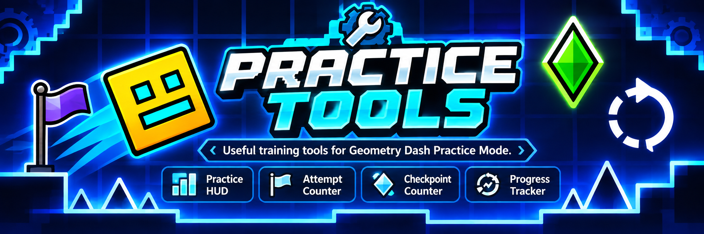

# Practice Tools

<p align="center">
  
</p>

<p align="center">
  <b>Useful training tools for Geometry Dash Practice Mode.</b>
</p>

<p align="center">
  
  
  
  
  
</p>

---

## About

**Practice Tools** is a lightweight Geode mod designed to improve your Geometry Dash Practice Mode experience.

It provides useful real-time statistics, allowing players to track their attempts, checkpoints, and progress while practicing difficult levels.

Practice smarter, improve your consistency, and conquer your next demon!

## Features

- **Practice HUD** — Displays useful practice statistics directly on your screen.
- **Attempt Counter** — Tracks your attempts during a practice session.
- **Checkpoint Counter** — Displays the number of active checkpoints.
- **Progress Tracker** — Shows your current and best practice progress.
- **Customizable Settings** — Enable or disable individual features through Geode settings.
- **Practice Only** — Automatically hides the HUD when playing in Normal Mode.

## Compatibility

| Component | Supported Version |
|---|---|
| Geometry Dash | 2.2091 |
| Geode | 6.0.0-alpha.2 |
| Platform | Windows |
| Mod Version | v1.0.0 |

## Installation

1. Install [Geode](https://geode-sdk.org/) for Geometry Dash.
2. Download `tomobao.practice-tools.geode` from the [Releases](https://github.com/TomoBao/Practice-Tools/releases) page.
3. Move the `.geode` file into your Geometry Dash `geode/mods` folder.
4. Launch or restart Geometry Dash.
5. Enable **Practice Tools** in the Geode mod menu.
6. Enter Practice Mode in any level.

The Practice Tools HUD will appear automatically.

## Configuration

Open the Geode menu, select **Practice Tools**, and open its settings.

| Setting | Description | Default |
|---|---|---|
| Practice HUD | Enable or disable the practice HUD | Enabled |
| Checkpoint Counter | Display active checkpoints | Enabled |
| Progress Tracker | Display current and best progress | Enabled |

## Building from Source

### Requirements

- Visual Studio C++ Build Tools
- CMake
- Git
- Geode CLI
- Geode SDK 6.0.0-alpha.2

### Clone the repository

```bash
git clone https://github.com/TomoBao/Practice-Tools.git
cd Practice-Tools
```

### Build the mod

```bash
geode build
```

The compiled mod will be generated inside the `build` directory:

```text
build/tomobao.practice-tools.geode
```

### Known Build